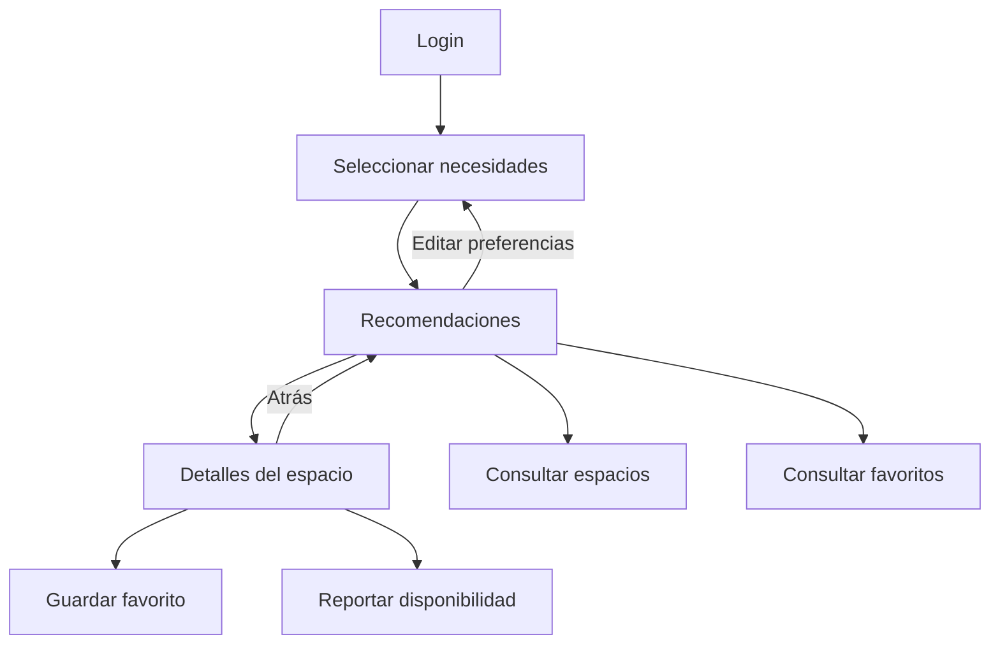
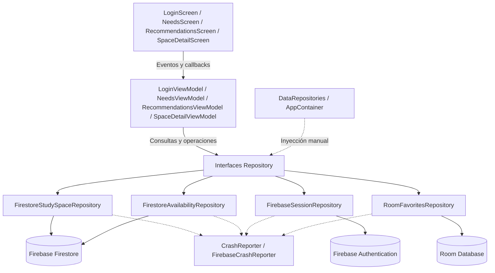

# UVGspot

Aplicación Android para encontrar espacios disponibles en la Universidad del Valle de Guatemala.

## 1. Problema y solución

**Usuario:** Tony Monroy, entrevistado durante la validación del problema.

**Problema validado:** Tony perdió aproximadamente 15 minutos buscando un lugar para estudiar, ya que la biblioteca y otros espacios que consideró estaban ocupados.

**Propuesta de valor:** UVGspot ayuda a estudiantes como Tony a encontrar espacios de estudio mediante recomendaciones personalizadas según sus necesidades y la disponibilidad estimada de los lugares.
## 2. Cómo ejecutar

**Requisitos:**
- Android Studio: [Versión utilizada]
- Android SDK mínimo (`minSdk`): [Valor de `app/build.gradle.kts`]
- Kotlin y Jetpack Compose.
- Conexión a internet para consultar Firebase.

**Pasos:**

1. Clonar el repositorio:

   ```bash
   git clone https://github.com/miguelsaj13/UVGspot.git
   ```

2. Abrir la carpeta `UVGspot` en Android Studio.
3. Seleccionar la rama correspondiente a la entrega final.
4. Esperar a que Gradle sincronice las dependencias.
5. Verificar que `app/google-services.json` esté presente.
6. Seleccionar un emulador o dispositivo Android compatible.
7. Ejecutar la aplicación mediante **Run**.

**Pruebas y compilación:**

En Windows:

```powershell
.\gradlew.bat testDebugUnitTest assembleDebug
```

En macOS o Linux:

```bash
./gradlew testDebugUnitTest assembleDebug
```

> El proyecto utiliza Firebase Firestore, Firebase Authentication, Crashlytics y Room. La configuración de firma para builds de distribución puede requerir archivos privados adicionales.

## 3. Flujo de usuario



**Descripción:** El estudiante completa el formulario inicial, selecciona sus necesidades y consulta los espacios recomendados. Puede abrir los detalles, guardar favoritos, reportar disponibilidad estimada y editar sus preferencias.

## 4. Arquitectura

UVGspot utiliza **MVVM + Repository**.



**Responsabilidades:**

- **UI:** muestra el estado y comunica eventos.
- **ViewModel:** administra el estado de presentación.
- **Repository:** centraliza el acceso a los datos y maneja errores.
- **Firestore:** almacena espacios y reportes de disponibilidad.
- **Room:** conserva los espacios favoritos localmente.
- **Crashlytics:** registra excepciones no fatales capturadas por los Repositories.

El algoritmo de recomendaciones se implementa en `RecommendationCalculator.kt` y utiliza las preferencias del estudiante junto con la disponibilidad estimada.

## 5. Mínimos técnicos

| ID | Implementación | Evidencia en el código |
|---|---|---|
| M1 | Pantallas del flujo principal y tema propio. | `ui/screens/`, `ui/theme/` |
| M2 | Navigation Compose, argumentos y navegación Atrás. | `navigation/AppNavigation.kt` |
| M3 | Lista de espacios mediante `LazyColumn` con `key`. | `ui/screens/recommendations/RecommendationsScreen.kt` |
| M4 | Formulario con validaciones en tiempo real. | `ui/screens/login/LoginViewModel.kt` |
| M5 | MVVM y estados mediante `StateFlow`. | `ui/screens/recommendations/RecommendationsViewModel.kt` |
| M6 | Acceso a datos mediante interfaces Repository. | `domain/repository/`, `data/repository/` |
| M7 | Inyección manual de Repositories. | `di/AppContainer.kt`, `di/AppViewModelFactory.kt` |
| M8 | Coroutines, `Flow` y `viewModelScope`. | `RecommendationsViewModel.kt`, Repositories |
| M9 | Lectura y escritura de Firestore. | `FirestoreStudySpaceRepository.kt`, `FirestoreAvailabilityRepository.kt` |
| M10 | Estados de carga, error y vacío; manejo sin conexión. | `RecommendationsUiState.kt`, `RecommendationsScreen.kt` |
| M11 | Persistencia de favoritos mediante Room. | `data/local/FavoritesDao.kt`, `RoomFavoritesRepository.kt` |
| M12 | Convenciones de Kotlin e identificadores en inglés. | Código del repositorio |
| M13 | Registro de excepciones no fatales con Crashlytics. | `CrashReporter.kt`, `FirebaseCrashReporter.kt` |
| M14 | APK distribuido mediante Firebase App Distribution. | ver PR |
| M15 | Verificación de estabilidad del flujo principal. | ver PR |

## 6. Alcance

### Historias de usuario originales

| ID | Historia de usuario | Implementación actual |
|---|---|---|
| F1 | Como estudiante universitario, quiero consultar la disponibilidad en tiempo real de los espacios de estudio para evitar recorridos innecesarios. | Parcial respecto a la historia original: se implementó disponibilidad estimada mediante reportes de estudiantes. |
| F2 | Como estudiante universitario, quiero filtrar espacios según ruido, capacidad y enchufes para encontrar un lugar adecuado. | Parcial respecto a la historia original: se implementaron preferencias y recomendaciones por puntuación, sin excluir espacios que no coinciden. |
| F3 | Como estudiante universitario, quiero visualizar la ubicación exacta y el mapa de los espacios libres para llegar directamente al lugar. | Parcial respecto a la historia original: se muestra edificio y nivel, pero no un mapa. |
| F4 | Como estudiante universitario, quiero conocer la capacidad y concurrencia actual de espacios grupales para evitar lugares saturados. | Parcial respecto a la historia original: se muestra disponibilidad estimada, pero no aforo ni cantidad exacta de personas. |

### Funcionalidades dentro del alcance implementado

- Selección de necesidades de estudio: ambiente, actividad, WiFi y enchufes.
- Recomendaciones personalizadas según las características y disponibilidad estimada.
- Consulta de detalles, ubicación por edificio y nivel, y características de los espacios.
- Reportes de disponibilidad estimada almacenados en Firestore.
- Favoritos persistentes mediante Room.

### Funcionalidades fuera del alcance implementado

- Ocupación exacta en tiempo real: no contamos con sensores ni datos institucionales.
- Filtros excluyentes: se priorizó un sistema de recomendaciones por puntuación.
- Mapas y navegación: requieren una integración adicional.
- Capacidad y cantidad exacta de personas: no contamos con datos verificables.
- Historial de espacios visitados: fue clasificado como Won't en la priorización original.

### Cumplimiento

UVGspot implementa el flujo principal de selección de necesidades, recomendaciones, consulta de espacios y disponibilidad estimada. Las diferencias respecto a las historias originales se documentan para distinguir las funcionalidades implementadas de aquellas que requerían información o recursos adicionales.

## 7. Referencias y uso de IA

**Documentación consultada:**
- [Kotlin Coding Conventions](https://kotlinlang.org/docs/coding-conventions.html)
- [Android App Architecture](https://developer.android.com/topic/architecture)
- [Jetpack Compose](https://developer.android.com/develop/ui/compose)
- [Firebase Firestore](https://firebase.google.com/docs/firestore)
- [Firebase Crashlytics](https://firebase.google.com/docs/crashlytics/android/get-started)
- [Firebase App Distribution](https://firebase.google.com/docs/app-distribution)
- [Room](https://developer.android.com/training/data-storage/room)
- [Navigation Compose](https://developer.android.com/develop/ui/compose/navigation)

**Uso de inteligencia artificial:**

Se utilizó **ChatGPT** como apoyo para implementar y revisar código, preparar pruebas unitarias, integrar Crashlytics y corregir errores.

Los resultados se verificaron mediante compilaciones con Gradle, pruebas unitarias, ejecución en Android Studio y comprobaciones en Firebase Console.
